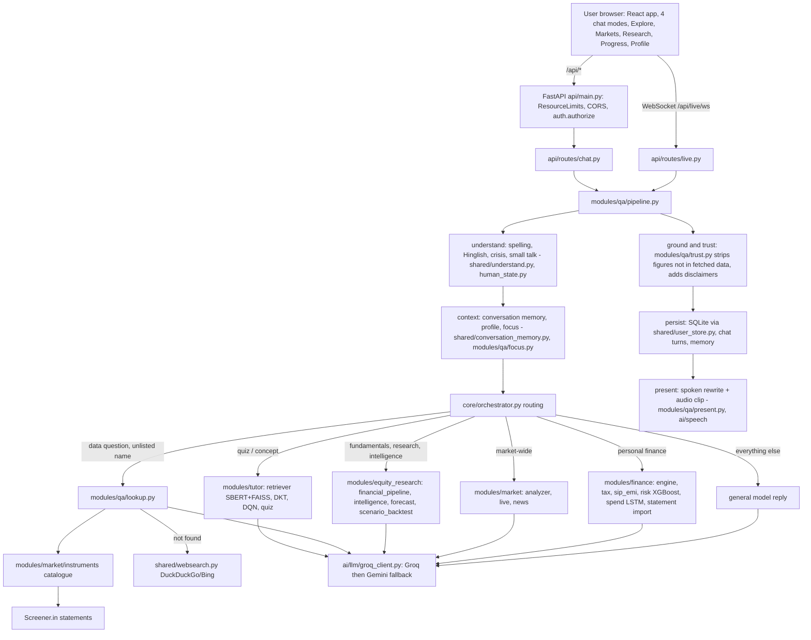

# ARIA architecture map

## End-to-end flow



## Module dependency layers (imports run downward)

```
web/src (components, v1/, v2/, api.ts)
   |  HTTP / WebSocket
api/routes/*  ->  api/auth.py, api/resource_limits.py, api/audio_store.py
   |
modules/qa  (pipeline, lookup, focus, trust, present)
   |
core/orchestrator, core/router, core/session
   |
modules/{tutor, finance, market, equity_research}   shared/{company_resolver, news, websearch, understand, intent_*, conversation_memory, vector_store, user_store}
   |
ai/llm (groq_client, prompt_templates, spoken)   ai/speech (stt Whisper, live_tts Piper/Edge)   config/{settings, paths}
   |
External: Groq, Gemini, Yahoo, Screener.in, AMFI, mfapi, CoinGecko, FRED, NSE/BSE, RSS feeds, DuckDuckGo/Bing, Tavus, Google sign-in
Storage: SQLite (chat, profile, transactions, learning, reports, audio, auth) + data/ caches + models/ (rebuilt by training scripts)
```

## Offline / batch pipelines

`scripts/scenario_backtest_universe.py` (resumable sweep over ~4,600 NSE/BSE companies, results in `data/scenario_backtest`), `scripts/scenario_report_validation.py` (report-level validation, robustness), `scripts/make_summary_pdf.py`, `scripts/validate_universe.py` (price-forecast sweep), training scripts for the finance and tutor models.

## Runtime shapes

Private mode (default, no login, client-supplied owner id), accounts mode (cookie sessions, optional Google), Docker (API serves the built web app on port 8000), development (Vite on 5173 proxying to 8000).
