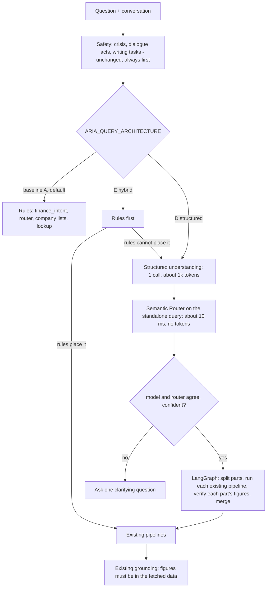

# Final architecture recommendation (provisional until the D/E test split is complete)

## Answers to the ten questions

1. **Primary root cause of the wrong and invented answers.** Among the failures actually observed, the largest measured source is routing: 45 of 259 benchmark questions (17%) ended in an unacceptable outcome for the baseline, and 12 of them fell straight to the general model, which has no data behind it. In this project's own incident list, three of four invented answers (the gold price, the Suzlon P/E, "no recorded information" for Kaynes) were that fall-through; the fourth (every figure stripped from a Reliance answer) was a bug in the grounding stage, fixed earlier. This is anecdotal for generation-level hallucination, which was **not** measured per variant.
2. **Intent versus retrieval/generation.** Of the 43 wrong routes, 12 were fall-through, 20 neighbouring-module confusions, 9 multi-part questions, 2 tone-layer. Retrieval and generation were not measured at answer level; the numeric grounding stage catches 94.3% of invented figures and wrongly flagged none of 210 clean sentences.
3. **Did Semantic Router improve routing?** No, not here. 0 fixed / 0 broken on dev, 0 fixed / 2 broken on test (p=0.50), and worse as an override (6 fixed / 10 broken on test). The encoder (ARIA's small Sentence-BERT) with 93 examples is too weak to beat the rules. A larger encoder or many more examples might change this; that was not tested.
4. **Did LangGraph improve multi-part execution?** Yes, modestly: multi-intent coverage rose from 0.50 to 0.61 (test) and 0.455 to 0.727 (dev); single-question accuracy was unchanged on dev (1 fixed, 1 broken) and +2 on test; samples are small (11 dev, 9 test multi-intent items). Parallel execution did not work in production (deadlock) and is off.
5. **Does structured LLM understanding justify its cost?** Evidence leans yes but is not proven: dev 91.5% vs 83.7% (p=0.041, tuned on dev), recorded part of test 90.7% vs 86.7% (n=75, p=0.58). Cost: about 1.0k tokens and 0.9 s of model time per query for D (on 80% of queries), 0.2k tokens and 0.17 s for E, which calls the model only when the rules cannot place a question.
6. **Is fine-tuning necessary?** Not shown. The failures are mostly in the rule layer's brittleness, not in the model's language understanding; 259 labelled items are far too few to fine-tune anything.
7. **If it becomes beneficial:** a small encoder classifier (tens of millions of parameters, contrastive/SetFit-style tuning) trained on a few thousand real, labelled ARIA queries to replace the router's weak embedding, keeping the large model for ambiguity only. This is a recommendation, not a measurement.
8. **Best accuracy-cost-latency balance.** On current evidence E (rules first, model for the residual) is the cheap, safe step (+1.3 to +2.3 points, not significant, about 5x cheaper than D); D has the best numbers (+4 to +8 points) at about 5x the tokens and has not yet been confirmed on the full held-out split.
9. **Production architecture.** Keep `baseline` as the default today. Do not enable B (no benefit, small risk). Enable E, and later D if the full test split confirms it, first in **shadow mode** (compute the decision, log disagreements, do not act) behind the flag; shadow mode is not implemented yet and is the next engineering step. The crisis-detection fix, the grounding fixes and the lookup layer are architecture-independent and are already in.
10. **Limitations.** Benchmark labels were written by one author and one audit agent (no second human rater); 259 items, small per category; D/E test split incomplete (75 of 130 recorded); one model (`gpt-oss-120b`) measured; legacy follow-up resolver disabled in all variants; thresholds chosen on 129 dev items; no end-to-end hallucination rate; unsupported-topic handling unsolved; sequential graph only.
