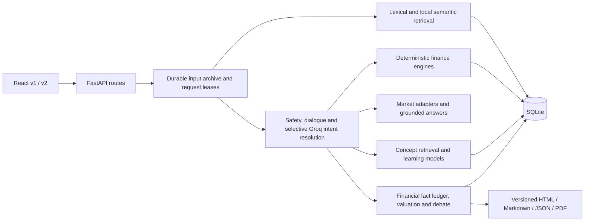

# ARIA system audit — 2026-10-16, continued 2026-10-17

**Overall status: PARTIALLY VERIFIED.** Major local workflows have executable regression coverage, real Chromium testing, and direct SQLite persistence checks. Optional email/password and Google account integration has been added, while the current application stays in private mode. This is not a certification that every control, deployment, model answer or possible defect is correct. Live Google consent, production hardening and physical voice/video remain outside the verified result.

## Preservation and isolation

- Work continues from the existing working tree on `audit/system-review-20261016`. Existing changes were not reset or committed over.
- `.audit/pre-audit-tracked.patch` preserves the original tracked diff; `.audit/pre-audit-untracked.zip` preserves untracked source. Environment files, virtual environments and dependencies were excluded from the archive.
- `.env` was not edited or printed. No production deployment, paid video conversation, tunnel, or external message was started.
- The initial baseline attempt exposed legacy tests that could open the configured application database. That attempt was stopped; the recorded baseline and all subsequent pytest runs use a temporary SQLite database set **before imports**. The initial attempt used legacy synthetic test owners; a byte-for-byte guarantee about the original database was not established.
- Browser tests launch their own API on `127.0.0.1:8765`, Vite on `127.0.0.1:5175`, and a uniquely named database under `.audit/browser/`. They refuse to reuse an existing server. The separate restart test refuses an occupied port 8766.
- Browser providers are synthetic; API routing, validation, financial computations, report generation/rendering, HTTP requests and SQLite writes are real. Browser mocks are confined to `scripts/audit_server.py`, never enabled by a production environment flag.

## Architecture and data paths



`VersionRouter` mounts v1 or v2. The root `web/src/components` tree is also compiled but is not the selected application entry point. Shared frontend behavior is copied into the two versions, so fixes must be propagated deliberately. This audit fixes affected copies without replacing the user's interface work.

Profiles, transactions, learning state, reports and conversation archives use SQLAlchemy/SQLite. In default private mode owner IDs remain client-generated capabilities. Optional account mode uses server-validated HttpOnly cookie sessions and checks supplied owners against the account; unscoped paid-video and compute integrations are blocked in that mode. Chat has durable request IDs/leases and replay; this does not make every financial side effect or background job a resumable distributed workflow. The continuations add owner-scoped statement previews, atomic import retry receipts and expiring completed-audio capabilities to SQLite. Pending synthesis callables remain process-local. Reports retain versions, timestamps, sources and an audit ledger; financial calculations are separate from LLM narration.

The current static inventory records **72 route declarations and 546 control templates** in `.audit/inventory.json`, including the auth router and health endpoint. Its route count was independently matched to the installed FastAPI app's nested registrations using an in-memory database. Templates include map-generated controls and legacy copies; those numbers are not a browser coverage percentage. Accessible controls observed on eight routes in each UI are attached to Playwright results.

## Findings and remediation register

Severity describes impact in the applicable workflow, not a claim of an exploited vulnerability.

| ID | Severity | Reproduction / root cause | Change and regression evidence |
|---|---|---|---|
| A01 | High | Run legacy pytest with the configured DB; store imports open it before fixtures run. | Global temporary test DB established before API imports; all recorded regression runs isolated. |
| A02 | High | Save rent and food, clear rent, save again: omitted rent is merged back by the partial-update API. | Frontend sends explicit null for removed nested values. Both browser versions check SQLite retains food and removes rent, then reload/new session. Nested forget also sends a tombstone. |
| A03 | High | Submit negative/nonfinite amounts, invalid dates/categories, or missing sample owner. Invalid values could be stored or missing keys cause 500. | Bounded transaction schema with calendar validation, finite positive amount, known categories/channels and bounded strings. API regressions confirm rejection without writes. |
| A04 | Medium | Fail transaction POST: rejected promise gives no useful recovery; spending insights do not refresh on mutations. | Visible error, guarded submission, preserved input, refreshed transactions/insights. Browser injects 503 then successfully retries. |
| A05 | High | Voice endpoint reads the entire uploaded body; provider exceptions are returned verbatim. | Bounded 10 MB application read, empty-file rejection and private 502 message. Boundary/private-error API regressions. This is not a global request/admission limit. |
| A06 | High | Instrument ask omits the request owner context and can fail against an owner-bound conversation. | Ownership checked before providers; same durable turn wrapper, optional retry ID and context reset as chat. Cross-owner regression proves provider is not invoked. |
| A07 | High | A reply's `98765` matches volatility `99.0495` through arbitrary scaling; `300%` matches investment `300000`. | Scaling requires an explicit unit. Only fetched facts are numeric evidence; user questions/prior replies cannot authorize invented numbers. Regression covers both attacks and legitimate `300 thousand`. |
| A08 | Medium | A future/target-price request contains the word price. | Current-quote fast path excludes future/target requests; grounding retry/fallback remains exercised by target-price tests. Foreign-currency quote fast path explicitly verifies USD and no rupee substitution. |
| A09 | Medium | Unknown MF code receives metadata for another scheme. | Require returned scheme code to match; API 404 regression. |
| A10 | Low | Crypto fallback reports `CoinGecko + CoinGecko`. | Deduplicate source name; source/fallback regression. |
| A11 | High | Client `system_context` replaces the system policy and bypasses the normal crisis branch. | Context is quoted untrusted user data beneath a fixed conversation policy. Raw/normalized crisis queries use normal care routing with no provider call. Persistence/scoping and safety regressions. |
| A12 | High | Old-regime income just above rebate threshold receives new-regime marginal relief; senior basic exemptions are ignored. | Separate old-regime rebate and age bands; pass profile age to comparison. Independent reference cases plus existing finance tests. See tax scope below. |
| A13 | High | Dependency advisory scan: 123 records in 10 Python packages, one npm advisory. | Upgrade compatible API, PDF, multipart, torch and transport packages; update yfinance for curl compatibility. Persist direct pins/security constraints. Final advisory scans and pip compatibility checks rerun. Counts are advisory records, not 123 distinct application exploits. |
| A14 | High | Company intelligence receives a null news sentiment score; `toFixed()` crashes the page. | Nullable API types, unavailable formatter/labels in both interfaces and compiled legacy consumers. Real browser analysis workflow is the regression. |
| A15 | Test reliability | Instrument tests accidentally start background TTS; one assertion assumes an LLM call for a deterministic quote. | Isolate audio in text-grounding tests; assert actual grounded currency behavior and include owner on history lookup. Voice has its own tests. |
| A16 | Medium | Settings claimed messages were interpreted only on-device although requests use backend/cloud providers. | Corrected privacy copy in both versions and legacy tree; preferences remain local. |
| A17 | Test reliability | Single on/off wall-clock timing pair failed intermittently (78 ms versus 40 ms). | Keep the original 30 ms overhead budget; use nine paired samples with alternating order and the paired median, executing the real pipeline. No threshold increase or exclusion. |
| A18 | High for input integrity | Late onboarding profile response mounts an auto-focused income field while a user is typing in chat; browser trace showed `hello` in income and an empty composer. | Remove automatic initial focus theft in all interface copies. Browser regression delays the profile response, focuses the composer, then confirms focus remains there when onboarding appears. Explicit later onboarding steps retain keyboard focus behavior. |
| A19 | High | Statement preview disappears on restart; workers can read the same pre-insert state and duplicate rows; profile failure leaves committed transactions. | Durable SQLite preview/receipt table; acquire writer lock before reads; commit transaction rows, optional profile and receipt atomically. Fault injection, six-thread requests, two separate processes and three actual API lifetimes verify rollback/deduplication/replay. |
| A20 | High for untrusted spreadsheets | XLSX ZIP/shared-string/grid allocation occurred before the transaction-row limit. | Bound ZIP expansion/member count, sheets, dimensions and grid cells; close workbook on rejection. Small synthetic archive/dimension regression fixtures prove the bounds precede decoding/allocation. Other parser and global admission limits remain R02. |
| A21 | High for data integrity | Uploaded JSON numeric overflow can bypass the manual-transaction schema and reach the import store. | Reject nonfinite, out-of-range or sub-paisa rounded amounts before creating a preview. API regressions prove no preview is stored. |
| A22 | Medium | Confirmed statement averages claim to replace spending, but partial-profile merge retains old categories omitted by the statement. | Send explicit null tombstones for omitted old expense categories within the same transaction; regression verifies replacement without changing unrelated facts. |
| A23 | High before public deployment | Multipart/JSON parsing has no overall wire-body bound, and concurrent requests/speech submissions have no admission budget. | Pre-parser byte/time bounds, per-worker active-request and peer-rate admission, bounded speech queue and cache. Raw ASGI tests check chunked/dishonest bodies, limits and recovery. Deployment-wide/OS quotas remain open. |
| A24 | High for untrusted statements | Legacy Excel loads every sheet through pandas; PDF/text/JSON construction can amplify input before transaction limits apply. | On-demand bounded XLS grids with resource cleanup; PDF page/decoded-stream/text checks; bounded text/JSON/OFX construction. Native decoder allocation/CPU isolation remains open. |
| A25 | Medium | Completed speech tokens disappear on restart although chat history still references them. | SQLite capabilities and managed expiring clips; actual API serves the clip across three process lifetimes after source removal. Pending synthesis cannot resume. |
| A26 | High for authenticated deployments | Client owner UUIDs do not prove an account identity. | Optional email/password and Google integration, durable revocable cookie sessions, exact-Origin mutations, owner checks and browser account switching. Private mode remains the default. Shared paid video/compute is blocked in account mode; live Google consent is not verified. See ACCOUNT_AUTHENTICATION.md. |
| A27 | High for forecast data integrity | The full live rerun returned a missing final Yahoo close; loader passed NaN into forecasting data and failed its existing network assertion. | Exclude missing/nonfinite price bars without filling prices, warn in metadata, sanitize older cache reads and benchmark series. Deterministic regression plus the unchanged actual Yahoo test pass. Finite outliers remain flagged and retained. |
| A28 | High for startup availability | Existing Vite loads the new auth gate while an old API still returns health 200 and session 404. Launcher reuses the old API and declares readiness. | Backend source revision snapshot in health, workspace-verified stale-process restart, session/proxy readiness checks, and a bounded descriptive frontend error. Four Python regressions and one exact 404/retry Chromium workflow per UI. The user's actual backend was backed up/restarted, a second launch reused it, and real localhost startup was verified. See STARTUP_RECOVERY.md. |

## Verification matrix

The recorded offline baseline was **1,041 passed / 5 failed / 7 deselected**. The five instrument failures were investigated; they are not hidden by excluding that file. The initial audit's full run passed **1,075 tests**, including marked network and slow tests. The statement-import continuation's final one-command rerun is recorded separately under `.audit/rerun/`; consult its summary and JUnit for the last exact result.

**Preceding statement-import continuation:** 1,094 Python tests passed, zero failures/errors/skips (169.30 seconds in JUnit; 104 warnings). All 16 Chromium scenarios passed (55.95 seconds). The connections check failed because FRED timed out. The preceding evidence is preserved under `.audit/before-resource-final-run/` and `.audit/before-account-final-run/`; the initial pre-import audit is under `.audit/before-import-final-run/`.

**Latest final sequential rerun including startup recovery:** **1,143 Python tests passed**, zero failures/errors/skips (172.86 seconds in JUnit; 104 warnings). **All 22 Chromium workflows passed**: 18 private-mode scenarios (63.91 seconds) and four account scenarios (31.41 seconds), with no skips, unexpected failures or flaky retries. Build/types, lint, both actual restart checks, native memory, pip compatibility, Python advisories, npm advisories and live intent passed. Lint still emitted 73 warnings; Python and npm each reported zero known advisories. **Only the connections check failed: FRED ReadTimeout**, so the full runner correctly exited 1. Other public providers and synthetic Groq/Gemini probes passed. An earlier hardening run reproduced a real missing Yahoo close (1,118 passed / one failed); the unchanged live assertion passes after A27 and its deterministic cache/input regression. Learning-key/job isolation and the exact startup session-404/retry workflows are included in this latest full run. Pre-recovery evidence is preserved in `.audit/before-startup-recovery-final-run/`.

The final live intent run scored 10/12 routes and 9/12 joint route/reference checks, versus 7/12 and 4/12 in its baseline. Mean harness latency was about 721 ms versus 25 ms; 8 resolver calls consumed 4,289 prompt and 1,362 output tokens. This is the same small synthetic development fixture, not an independent human-quality benchmark.

| Area | Status | What is actually verified |
|---|---|---|
| Profile persistence | VERIFIED | Form save; raw SQLite values; nested deletion preserving sibling fields; navigation/back; refresh; new chat; fresh browser context retaining the same device identity; different device gets empty data. |
| Backend restart | VERIFIED | Three actual API process lifetimes against the same isolated DB; profile, transactions/chat, pending preview and completed import receipt survive. Retrying the import preserves a later profile edit and exact SQLite transaction count. Wrong chat owner gets 403. |
| Completed audio | VERIFIED with synthetic clips | Managed copy remains accessible through three actual API lifetimes after its source is removed; cache/queue/expiry and account-owner checks pass. Pending synthesis resumption and physical speech remain unverified. |
| Optional accounts | PARTIALLY VERIFIED | Email/password and explicit Google linking; actual SQLite session/revocation/CSRF/owner/legacy-learning/WebSocket checks. Four real Chromium scenarios verify profile persistence, logout across tabs, new browser login and authenticated report rendering/download. Google browser identity is synthetic; separate local RSA tests use the real verifier. Account cookies and copied-cookie revocation survive actual restarts. Live Google consent and public deployment are not verified. |
| Transactions/import | VERIFIED for exercised flows | Add, refresh/readback, clear, 15-row sample, CSV preview/import and identical retry in both browser versions. API tests cover formats, validation, owner/expiry checks, profile+transaction rollback and concurrent same/different preview IDs, including separate Python processes. |
| Chat | VERIFIED with fixture providers | Send, acknowledge, reload/history, clear; durable retry/lease/owner regressions; crisis path and custom context safety. Actual answer quality is a separate evaluation. |
| Reports | VERIFIED for exercised flows | Browser creates real synthetic report, opens sandboxed HTML, downloads HTML/Markdown/JSON, regenerates v2, cancels deletion then deletes one version, rejects other owner. Additional actual API PDF export returned 200 and a valid 23-page PDF; parsing confirmed synthetic company text. Live financial source accuracy, PDF/print UI and all optional report modes are not fully browser-tested. |
| Company intelligence | VERIFIED with synthetic financial data | Submit, render missing sentiment, new search, expand sentiment tool and submit; unavailable score no longer crashes. This does not verify live FinBERT quality. |
| Learning progress | PARTIALLY VERIFIED | API quiz answer persists and appears after browser reload. Tutor/quiz/model regressions run. A complete live LLM-generated quiz answered through every browser control is not demonstrated. |
| Explore/watchlist | VERIFIED for exercised flows | Open real instrument drawer, change chart range, add/remove watchlist, refresh persistence, close drawer. Not every asset/filter/SIP/empty/failure combination is exercised. |
| Settings/markets/navigation | VERIFIED for exercised flows | Tone/theme persistence, market fixture renders, version switch with full reload, eight route renders per UI and page-error checks. Mobile, Firefox, Safari and accessibility certification remain untested. |
| Financial/model functions | VERIFIED against tests | Tax reference cases; SIP/EMI, risk, budget, anomaly, forecast, leakage, scenario, valuation and report regressions, including slow LSTM/GRU tests. Passing synthetic backtests do not establish profitable predictions. |
| Local memory | VERIFIED on small synthetic set | Actual cached SBERT with upgraded torch: 10 sources + 30 distractors, recall@5 1.0, MRR@5 0.9. Source/correction/isolation/token budget/restart tests also run. No general long-term-memory accuracy claim. |
| Intent model | PARTIALLY VERIFIED | Live configured Groq model, 12 assistant-authored development cases. Earlier audit run: baseline 7/12 routes versus resolver 11/12; joint route/reference 4/12 versus 10/12, ~40 ms versus ~756 ms harness mean. Last run's metrics are in `.audit/rerun/intent.json`. These are not human-reviewed held-out results. |
| Security | PARTIALLY VERIFIED | Dependency scans, finite/bounded inputs, privacy of voice errors, owner checks, grounding and source-instruction regressions. No comprehensive penetration test or production authentication claim. |

The final private-mode browser suite comprises **18 passing scenarios**, nine per UI version. It captures page errors and failed-request diagnostics, attaches route control inventories, takes screenshots, and retains traces/screenshots on failure. Four additional passing account scenarios check both UI versions and the identity flows described above. Injected 503 responses and the session 404 are deliberate recovery tests. This is coverage of major workflows, not every one of the 546 templates.

## Live connections and unavailable dependencies

Read-only probes use synthetic prompts or public datasets. No profile, private transcript or uploaded statement is sent by the connection/evaluation scripts.

| Connection | Evidence / limitation |
|---|---|
| Groq | Synthetic exact-response probe and actual structured intent evaluation with configured `openai/gpt-oss-120b`. |
| Gemini | Synthetic exact-response probe with configured `gemini-3.6-flash`. This does not verify every fallback behavior in a live conversation. |
| AMFI, mfapi, CoinGecko, Yahoo | Public HTTP/schema checks passed; marked AMFI/mfapi/Yahoo history tests were included in the full regression. Freshness, historical revisions and market truth are not certified by connectivity. |
| FRED | NOT VERIFIED: actual CSV endpoint timed out at the 15-second read limit. Application fallback tests pass. The runner records this connection check as a failure rather than marking the whole audit green. |
| Tavus/ngrok | NOT VERIFIED live: no billed video session or public tunnel was created. Mocked callback/recovery tests ran. Credentials alone do not demonstrate working WebRTC/media. |
| Microphone/STT/TTS/avatar | PARTIALLY VERIFIED: API boundaries and component/unit protocols are exercised; no end-to-end physical microphone, speaker, browser permission or real-time lip-sync check. |
| External tracing/memory frameworks | Not configured or introduced; no user data exported to a new service. |

## Financial scope and assumptions

The corrected old-regime rebate and resident senior/super-senior exemptions follow the [Income Tax Department computation guide](https://www.incometaxindia.gov.in/w/computation-of-tax-for-individual-1). The module uses the guide's published AY 2026-27 normal-income slabs. New-regime rebate relief and the old-regime rebate are distinct.

Tax remains a demo estimate: the profile asks for take-home monthly income, while comparison annualizes it and assumes salary standard deductions. Gross salary, residency, special-rate capital gains, all employment cases, surcharge/reliefs and tax-year selection are not fully modeled. The age fix does not make this a filing calculator. This remains an explicit high-priority gap, not a verified financial recommendation.

SIP future value uses beginning-of-month contributions (annuity due), annual nominal rate/12 and rounded whole-month tenure; fees/tax are excluded. Its prior end-of-period docstring was corrected. Instrument historical SIP simulations have their own date/price conventions and must not be presented as the same calculation. Research macro discount/growth assumptions are configured assumptions; missing data must remain unavailable and sourced figures retain their period/currency.

## Architecture comparison and adoption decisions

These are design decisions from current official documentation, not local performance benchmarks of the candidate frameworks. They are alternatives with different costs; adding them all would not establish correctness.

| Candidate | Relevant capability | Decision for ARIA |
|---|---|---|
| [Mem0](https://docs.mem0.ai/core-concepts/memory-operations/search) | Persistent memory search and scoped retrieval. | Keep existing SQLite archive/retrieval for now. Consider an explicit fact lifecycle if the measured correction/staleness workload outgrows it; preserve financial provenance and confirmation boundaries. |
| [LangGraph](https://docs.langchain.com/oss/python/langgraph/persistence) | Thread checkpoints and cross-thread stores. | Current turns already have durable input/replay. Consider persistent graph checkpoints when multi-step tools require node-level resumption; do not equate a saved response with a resumable tool workflow. |
| [Graphiti](https://github.com/getzep/graphiti) | Temporal entity/relationship graphs. | Defer until entity/time reasoning has a labelled workload and operations budget. Financial ledger IDs, periods and corrections remain the first source of truth. |
| [Letta](https://docs.letta.com/v1-sdk/concepts/stateful-agents) | Stateful agents and managed memory. | Defer runtime replacement; autonomous memory edits must not become unconfirmed user financial facts. |
| [LlamaIndex](https://developers.llamaindex.ai/python/framework/) | Document ingestion, retrieval and query components. | Candidate if document research expands beyond current curated concepts and statement parsing. Evaluate against current retrieval before adopting. |
| [Haystack](https://docs.haystack.deepset.ai/docs/pipelines) | Composable retrieval/generation pipelines. | Alternative to a RAG rewrite, not another simultaneous stack. No migration demonstrated necessary by this audit's small corpus. |
| [Langfuse](https://langfuse.com/docs) | Tracing, evaluation and LLM observability. | Candidate for redacted operational tracing. Existing numeric usage/context logs are narrower; no tracing deployment or new data export was silently introduced. |
| [promptfoo](https://www.promptfoo.dev/docs/intro/) | Repeatable model/prompt evaluation and assertions. | Useful candidate after human-reviewed finance/general/Hinglish and adversarial datasets exist. Current Python eval fixtures remain small and documented; do not market them as broad intelligence evaluation. |
| [Playwright](https://playwright.dev/docs/test-webserver) | Real browsers with managed local web servers and evidence. | Adopted now as a dev dependency because it directly catches save/persistence/render/control failures missed by builds and API tests. |

## Remaining gap register

| ID | Priority | Reproducible limitation / next acceptance criterion |
|---|---|---|
| R01 | Partially closed, high before public deployment | Optional account mode now has email/password and Google integration, revocable sessions, account-owner checks, CSRF protection, browser persistence/switching and actual restart evidence. Default private mode still trusts owner capabilities and must stay local. Live Google client/consent, email verification/recovery/MFA/roles, private-data migration and account isolation for shared paid-video/compute remain open. |
| R02 | Partially closed, high before public deployment | XLSX expansion, legacy XLS grids, PDF page/stream/text and text/JSON matrices now have limits. Overall wire-body/time, active requests, peer rate and speech queue/cache admission are bounded (A23/A24). Native decoder allocations, hard CPU/process/disk limits, deployment-wide rates and authenticated account quotas remain open. These checks do not establish a parser sandbox. |
| R03 | High for tax use | Take-home versus gross tax base and tax-scope issues above. Add explicit gross/residency/employment/year inputs and independent reference cases before presenting precise tax decisions. |
| R04 | Partially closed | Statement previews, transactional retries and multiworker deduplication are verified (A19). Completed audio capabilities/clips now survive restart (A25), with bounded queue/cache and one-hour expiry. Pending synthesis callables cannot resume. Cleanup is lazy, not scheduled deletion. Preview replay is limited to ten minutes and explicit clear/delete invalidates it. |
| R05 | Medium | Model intent evaluation has 12 development examples; broader human-reviewed general, multilingual/Hinglish, ambiguous, correction and refusal precision/recall cases are absent. Actual routing misses remain in the JSON; no fixture relabelling to force a pass. |
| R06 | Medium | Browser coverage omits real voice/video, mobile/accessibility, PDF/print UI, every conditional control and every optional heavy job action. Extend tests by explicit workflows, not build status or static counts. |
| R07 | Medium | Frontend lint returns success with warnings (73 in the recorded check), including existing hook/ref/purity/key issues. No claim of warning-free lint. API startup/testclient deprecations and scientific-library warnings remain recorded. |
| R08 | Medium | v1/v2/root UI copies can drift. Consider extracting shared state/API/forms after agreeing which snapshots must remain independent; broad visual consolidation was not forced into this audit. |
| R09 | Medium | Provider-specific retention/consent documentation is still incomplete. The inaccurate on-device settings claim was corrected (A16); no provider retention guarantees were inferred. |
| R10 | Medium | No calibrated production p95/load benchmark, chaos test or universal tool side-effect journal. The reported browser/eval timings apply to these fixtures on this machine only. |

## Reproduce and inspect evidence

From `E:\ARIA`, install the pinned dev requirements and `npm ci` in `web`, then install Chromium once using `npx playwright install chromium` from `web`.

```powershell
.venv\Scripts\python.exe -m scripts.run_system_audit --live
```

This runs full pytest (including marked tests), frontend build/types/lint, real Chromium tests, an actual API restart, native semantic memory eval, pip compatibility/advisory scans, npm advisory scan, public connections and optional synthetic LLM probes. `--live` permits small configured-provider calls; omit it to omit those LLM calls. Cached SBERT is required for offline native evaluation. It never starts Tavus/ngrok. Inspect per-check results even when other checks pass.

Authoritative local artifacts:

- `.audit/rerun/summary.json`, `regression.xml` and per-check logs: final sequential run.
- `.audit/browser-results/results.json`: final scenario counts, attached controls/diagnostics, screenshots and retained failure traces.
- `.audit/account-browser-results/results.json`: four account workflows, page-error checks and failure diagnostics.
- `.audit/restart-results.json`: actual process restart/storage assertions.
- `.audit/account-restart-results.json`: actual account-session/profile restart and persistent copied-cookie revocation assertions.
- `.audit/runtime-recovery/`: ignored local pre-restart SQLite backup, recovered-page screenshot and live session/composer check. Existing rows matched the backup across all ten pre-existing tables; no row contents were printed. This smoke check intercepts chat history to avoid creating a test conversation in the real DB.
- `.audit/pdf-export.json` and `synthetic-report.pdf`: additional actual API export, PDF signature/page/content checks using headless test Chromium; this manual check is separate from the one-command runner.
- `.audit/rerun/native_memory.log`, `intent.json`: measured retrieval/intent outputs.
- `.audit/python-advisories*.json`, `.audit/rerun/python_advisories.log`, `.audit/rerun/npm_advisories.log`: security scans.
- `.audit/live-connections.json` and `.audit/live-connections-with-llm.json`: public/current and earlier synthetic provider evidence.
- `reports/SYSTEM_AUDIT_RESULTS.json`: portable summary without credentials/private records.

For rollback, preserve the current work first. Restore original source in a **separate copy** using the original branch HEAD plus the pre-audit tracked patch/untracked archive; do not reset this dirty tree. `.audit/pre-security-requirements.txt` records the prior Python environment; restore it only in an appropriate isolated environment. Runtime dependencies and the npm lockfile changed. The statement continuation adds the `statement_previews` table through normal startup initialization; existing rows are not rewritten. Its source backup, expiry/privacy semantics and test evidence are documented in [statement import reliability](STATEMENT_IMPORT_RELIABILITY.md). Do not automatically drop the new table when reverting source.

The later continuation adds `audio_artifacts`, `auth_accounts`, `auth_sessions`, `auth_throttles` and an additive audio owner column. Private mode remains the default; `.env` was not changed. See [resource/audio limits and retention](RESOURCE_AND_AUDIO_HARDENING.md) and [account configuration, scope, migrations and rollback](ACCOUNT_AUTHENTICATION.md). Reverting to private mode removes account protection and must not be used as a public-server rollback. Those regression servers use isolated databases. The subsequent [startup recovery](STARTUP_RECOVERY.md) backed up the user's local SQLite database and deliberately restarted its outdated API, so normal startup applied the additive schema there. Existing row content was compared against the backup and preserved across all ten pre-existing tables.
